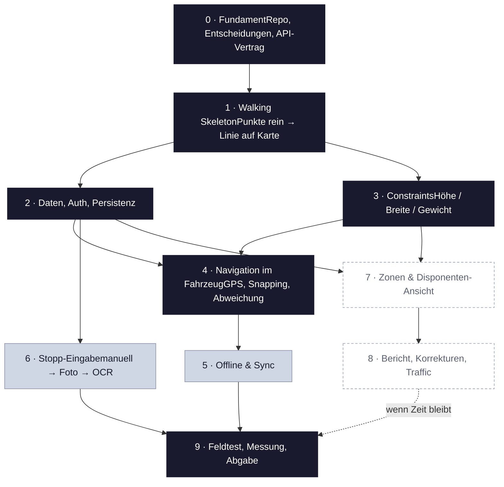
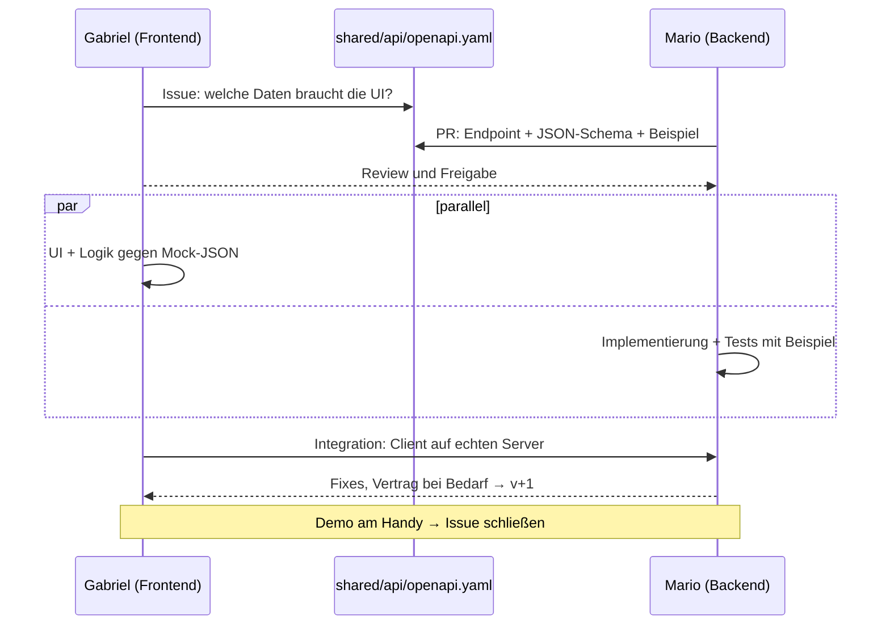

# VoBi-Tour – System-Architektur-Workflow

Wegweiser von oben nach unten: in welcher Reihenfolge wir bauen, wer was macht und an welchen Übergabepunkten Frontend (Gabriel) und Backend (Mario) zusammenkommen. Baut auf dem Architektur-Gesamtmodell auf (Client Qt/QML ↔ REST ↔ Server mit PostgreSQL/PostGIS/pgRouting).

## Spielregeln, damit wir uns nicht blockieren

**1 · Zuerst der API-Vertrag**Jedes Feature startet mit einem Eintrag in `shared/api/openapi.yaml`: Endpoint, JSON-Schema und ein Beispiel-Response. Beide geben den PR frei, erst danach wird gebaut.

**2 · Niemand wartet**Gabriel baut gegen Mock-JSON (die Beispiele aus dem Vertrag), Mario testet mit `curl`/Unit-Tests. Integriert wird, sobald beide Seiten fertig sind.

**3 · Dünner Durchstich vor Breite**Zuerst funktioniert ein Ablauf komplett von Anfang bis Ende (wenn auch hässlich), dann wird ausgebaut. Keine Schicht wird „fertig poliert“, bevor der Rest überhaupt existiert.

**4 · Eine Phase = ein GitHub-Milestone**Issues mit den Labels `frontend`, `backend` und `contract`. Eine Phase gilt als fertig, wenn die Demo am echten Handy läuft, nicht nur „bei mir am PC“.

**5 · Gemeinsame Testdaten**Ein fixer OSM-Ausschnitt (z. B. ein Grazer Bezirk) plus ein Set aus \~20 Test-Stopps im Repo. Beide testen mit genau denselben Daten.

**6 · Diplomarbeit läuft mit**Jede Phase liefert einen Absatz für die Arbeit: Entscheidung, Begründung, Messwert. Am Ende nicht alles nachschreiben.

## 1. Reihenfolge & Abhängigkeiten

**Kritischer Pfad:** 0 → 1 → 3 → 4. Die Constraints (Phase 3) stehen im Titel eurer Arbeit, deshalb kommen sie *vor* Offline, OCR und Zonen. Dunkel = Must, grau = Should, gestrichelt = Could (siehe Scope-Tabelle unten).

## 2. Roadmap von oben nach unten: wer macht was

Frontend · Gabriel\
Qt/QML, Client-Logik, SQLite

Übergabe / Vertrag

Backend · Mario\
REST, Services, PostgreSQL, Routing

0

### Fundament

MUSTZiel: beide können am ersten Tag parallel loslegen

- Qt-6-Projekt mit CMake anlegen, App startet auf Desktop **und Android**
- Karten-Technik entscheiden: Qt Location (OSM-Plugin) oder MapLibre Native Qt, mit einem Prototyp, der eine Linie zeichnet
- Ordnerstruktur Client: `ui/ · logic/ · data/ · net/`

Gemeinsam entscheiden

- Monorepo: `client/ server/ shared/api/ data/`
- Server-Sprache & Framework
- Branch-Strategie, PR-Review durch den anderen
- `openapi.yaml` v0: `POST /tours/optimize`
- Ein Deployment-Modus für V1 (siehe Kritikpunkte)

- PostgreSQL + PostGIS + pgRouting per Docker Compose
- OSM-Ausschnitt mit `osm2pgrouting` importieren
- Server-Gerüst mit Health-Endpoint `GET /health`

**Fertig wenn:** beide checken Code aus, `docker compose up` läuft, die Client-App zeigt auf dem Handy eine Karte, der Vertrag v0 ist gemergt.

1

### Walking Skeleton

MUSTZiel: 5 Koordinaten rein → optimierte Linie auf der Karte

- Stopps per Tippen auf die Karte setzen (noch ohne Adresse)
- API-Client: Request senden, GeoJSON-Antwort parsen
- Route + nummerierte Stopps zeichnen
- Server-IP in den Einstellungen änderbar (`127.0.0.1` / Firmen-IP)

Meilenstein „Linie auf der Karte“ Request: Liste von Koordinaten + Startpunkt.\
Response: Reihenfolge + GeoJSON-LineString + Distanz/Zeit.\
\
Gabriel baut zuerst gegen das Beispiel-JSON aus dem Vertrag.

- Punkt → nächster Straßenknoten (Snapping in PostGIS)
- `pgr_dijkstraCostMatrix` → OR-Tools (TSP) → Reihenfolge
- `pgr_dijkstra` pro Teilstrecke → Geometrie zusammensetzen
- Erste Zeitmessung: 10 / 25 / 50 Stopps

**Fertig wenn:** am Handy 5–10 Punkte setzen → „Optimieren“ → Route erscheint. Die Laufzeiten sind gemessen und für die Arbeit notiert.

2

### Daten, Auth, Persistenz

MUSTZiel: Touren existieren dauerhaft, nicht nur im RAM

- Login-Screen, Token speichern
- Repository-Schicht + SQLite-Schema (Spiegel der Server-Entitäten)
- Tourliste, Tour-Detail, Stopp-Detail (Name, Beschreibung, Fotos anzeigen)
- Fahrzeug auswählen

API v1 einfrieren CRUD für `/tours`, `/stops`, `/vehicles`, `/auth`.\
Jede Entität hat `id` (UUID, darf am Client erzeugt werden), `updated_at` und `version`, weil Phase 5 das braucht.

- DB-Modell aus Milestone V1.0 umsetzen (User, Fahrzeug, Adresse, Stopp, Tour, Tonne)
- Auth (Token), Rollen: Fahrer / Disponent
- Tour-, Stop- und Vehicle-Service
- Optimize-Ergebnis an eine Tour speichern

**Fertig wenn:** App schließen und neu öffnen → Tour ist noch da. Auf einem zweiten Gerät einloggen → dieselbe Tour.

3

### Constraints: Höhe, Breite, Gewicht

MUSTZiel: der LKW wird nie über eine Strecke geschickt, die er nicht befahren darf

- Fahrzeugprofil anzeigen und bearbeiten (Höhe, Breite, Gewicht)
- Karten-Overlay: Durchfahrtshöhen, Maximalgewichte, Breiten
- Warnungen in der Route darstellen (Symbol + Text)
- Unterschied „Route mit / ohne Constraints“ anzeigen

Vertrag erweitern Der Optimize-Request bekommt `vehicle_id`, die Response bekommt `warnings[]` (Typ, Position, OSM-Wert).\
Neu: `GET /restrictions?bbox=` für das Overlay.

- OSM-Tags `maxheight / maxwidth / maxweight` beim Import mitnehmen
- Constraint-Check: gesperrte Kanten aus dem Graphen filtern
- Regel für *fehlende* Werte festlegen (unbekannt ≠ sicher)
- Testfälle: eine bekannte Unterführung muss umfahren werden

**Fertig wenn:** derselbe Stopp-Satz liefert mit „Kleintransporter“ und „3,8-m-LKW“ nachweislich verschiedene Routen. Das ist euer Kern-Beweis für die Arbeit.

4

### Navigation im Fahrzeug

MUSTZiel: der Fahrer sieht live, wohin er als Nächstes fährt

- GPS-Position (Qt Positioning), Karte folgt dem Fahrzeug
- Snapping der Position auf die Route (läuft am Client, braucht keinen Server)
- Abweichung: bei 50 m Hinweis, bei 150 m Neuberechnung anstoßen
- „Nächster Stopp“-Ansicht, Stopp als erledigt markieren
- GPS-Spur aufnehmen und abspielen, damit am Schreibtisch getestet werden kann

Neuberechnung `POST /tours/{id}/recalculate` mit aktueller Position + offenen Stopps.\
Ziel-Antwortzeit festlegen (z. B. \< 3 s), sonst ist die Funktion im Auto nutzlos.

- Recalculate-Endpoint: nur die Reststrecke ab der aktuellen Position
- Route-Cache (gleiche Kanten nicht neu berechnen)
- Stopp-Status serverseitig speichern

**Fertig wenn:** eine aufgezeichnete Testfahrt mit absichtlichem Verfahren löst die Neuberechnung aus, und die Route passt sich an.

5

### Offline & Sync

SHOULDZiel: ein Funkloch zerstört keine Daten

- Netz-Monitor, Offline-Banner in der UI
- Outbox-Tabelle in SQLite: jede Änderung als Eintrag
- Offline: Stopp manuell einfügen (ohne Neuberechnung, an der Position eingereiht)
- Wieder online: Outbox abarbeiten, Konflikte anzeigen

Sync-Protokoll `POST /sync` nimmt eine Liste von Änderungen mit Idempotenz-Key und liefert alles, was sich seit `last_sync` geändert hat.\
Konfliktregel *vorher* schriftlich festlegen.

- Sync-Service, Versionsprüfung pro Datensatz
- Doppelte Requests erkennen (Idempotenz)
- Delta-Abfrage seit Zeitstempel

**Fertig wenn:** Flugmodus an → 2 Stopps erledigen + 1 einfügen → Flugmodus aus → der Server hat alles, nichts ist doppelt.

6

### Stopp-Eingabe: manuell → Foto → OCR

SHOULDZiel: Lieferschein rein, Stopp raus, in drei Ausbaustufen

- **Stufe A:** Adresse eintippen mit Autovervollständigung
- **Stufe B:** Foto aufnehmen (Qt Multimedia), hochladen, Upload-Status anzeigen
- **Stufe C:** erkannte Felder anzeigen, der Fahrer bestätigt oder korrigiert sie

Asynchroner Job `POST /stop-inputs` (Bild) → `job_id`.\
`GET /stop-inputs/{job_id}` → Status + erkannte Felder + Geocoding-Treffer mit Konfidenz.

- **A:** Geocoding-Endpoint (z. B. eigenes Nominatim oder externer Dienst)
- **B:** Job-Queue + Bildablage
- **C:** OCR (z. B. Tesseract), zuerst für *eine* fixe Lieferschein-Vorlage

**Fertig wenn:** Stufe A ist Pflicht. B und C sind Zusatz: 20 echte Lieferscheine durchschicken und die Trefferquote für die Arbeit messen.

7

### Zonen & Disponenten-Ansicht

COULDZiel: der Disponent plant Gebiete, das System optimiert innerhalb

- Desktop-Layout für den Disponenten (gleiche Codebasis, anderes QML)
- Zonen anzeigen, Polygone verschieben, löschen, neu zeichnen
- Ein- und Ausstiegspunkte setzen
- Vergleich: vorgeschlagen ↔ angepasst

Zonen-API `POST /tours/{id}/zones/suggest`, `PUT /zones/{id}` (GeoJSON-Polygon), danach Optimize pro Zone.

- Zonen-Vorschlag über PostGIS-Clustering (`ST_ClusterDBSCAN` o. ä.)
- Sonderfälle: lange Straßen, Sackgassen
- Optimierung pro Zone + Gesamttour zusammensetzen
- Seitenlogik (Seitenwechsel nur ≤ 50 km/h)

**Fertig wenn:** Disponent passt eine Zone an → neue Tour → die Differenz in km/min wird angezeigt.

8

### Bericht, Korrekturen, Traffic

COULDZiel: Feinschliff, falls Zeit bleibt

- Fahrer meldet eine Korrektur („Durchfahrt nur 3,2 m“), der OSM-Originalwert bleibt sichtbar
- Tour-Bericht ansehen und teilen
- Traffic-Layer (nur Anzeige)

Erweiterungen `/corrections`, `/tours/{id}/report`. Traffic ändert die Route *nicht*, das bleibt bewusst so.

- Korrekturen-Service, Korrekturen fließen in den Constraint-Check ein
- Ergebnis-Builder: Bericht (geplant vs. gefahren)
- Traffic-API anbinden

**Fertig wenn:** eine Korrektur beeinflusst die nächste Routenberechnung nachweisbar.

9

### Feldtest, Messung, Abgabe

MUSTZiel: Zahlen statt Behauptungen

- Echte Testfahrt (oder Mitfahrt) mit GPS-Aufzeichnung
- UI-Bugs aus dem Feldtest beheben
- Screenshots / Screencast für Arbeit und Präsentation

Code-Freeze Ab hier nur noch Bugfixes. Benchmark-Tabelle: Stopps vs. Laufzeit, Route mit vs. ohne Optimierung, mit vs. ohne Constraints.

- Performance-Messreihe (Matrix-Größe, OR-Tools-Zeitlimit)
- Deployment-Anleitung (Docker), Datenimport reproduzierbar
- Lizenz-Übersicht (pgRouting GPL usw.)

**Fertig wenn:** eine fremde Person baut das Projekt mit eurer README nach, und die Arbeit enthält echte Messwerte.

## 3. Ablauf pro Feature (gilt in jeder Phase)

Wenn sich der Vertrag während der Umsetzung ändern muss, kommt zuerst ein PR auf `openapi.yaml` und erst dann der Code. Sonst driften Client und Server auseinander, und ihr merkt es erst bei der Integration.

## 4. Scope-Schnitt (MoSCoW)

| Priorität | Inhalt | Begründung |
| --- | --- | --- |
| MUST | Phasen 0–4, 9; manuelle Stopp-Eingabe (6A) | Ohne diese Teile gibt es keine „constraint-basierte Tourenoptimierung“, so wie es der Titel verspricht. |
| SHOULD | Offline & Sync (5), Foto-Upload (6B), OCR für eine Vorlage (6C) | Steht in der Projektbeschreibung (Lieferscheine scannen), ist aber technisch riskant. Deshalb in Stufen. |
| COULD | Zonen + Disponent (7), Korrekturen, Bericht (8) | Wirkt stark, ist aber eigentlich eine eigene Diplomarbeit. Nur angehen, wenn 0–5 stabil laufen. |
| WON’T (V1) | Traffic beeinflusst die Route; mehrere Fahrzeuge gleichzeitig (VRP); Mini-PC *und* Firmenserver parallel | Jeder dieser Punkte verdoppelt den Testaufwand. |

## 5. Ehrliche Kritikpunkte am aktuellen Plan

**Der Umfang ist zu groß.** Die Architektur enthält OCR, Zonen-Engine, Offline-Sync, Korrekturen, Traffic und Navigation. Jeder dieser Blöcke ist für sich schon ein ordentliches Teilprojekt. Ohne harten Scope-Schnitt habt ihr am Ende zehn halbfertige Features statt vier, die funktionieren.

**Die Server-Sprache ist noch offen und blockiert Mario.** C++ (z. B. Drogon oder Qt HttpServer) passt zum Qt-Stack, und ihr teilt euch eine Sprache. Python (FastAPI + OR-Tools) ist für REST, OCR und Geocoding deutlich schneller entwickelt. Die schwere Rechenarbeit läuft so oder so in PostgreSQL/pgRouting und OR-Tools, nicht im Webserver. Entscheidet das in Phase 0, nicht später.

**Zwei Deployment-Modi bedeuten doppelte Tests.** Mini-PC im Fahrzeug und Firmenserver gleichzeitig ist zu viel. Für V1 reicht ein Server (Docker am Laptop oder in der Schule). Die Server-IP bleibt im Client umstellbar, damit ist der zweite Modus später nur eine Konfigurationsfrage.

**OSM-Daten sind lückenhaft.** `maxheight` fehlt an vielen Stellen. Wenn „kein Wert“ als „frei befahrbar“ behandelt wird, ist der Kern eurer Arbeit angreifbar. Legt die Regel fest (warnen? meiden?) und messt, wie viel Prozent der Kanten im Testgebiet Werte haben. Das ist übrigens ein gutes Kapitel für die Arbeit.

**Früh am echten Handy testen.** Qt Location, GPS-Berechtigungen und Kamera auf Android sind typische Zeitfresser. Deshalb verlangt Phase 0 schon „App läuft auf Android“. Wer das bis zum Schluss aufschiebt, verliert dort Wochen.

**Noch offen und vor Phase 1 zu klären:** Server-Framework · Kartenbibliothek (Qt Location vs. MapLibre) · Kartenkacheln (eigener Tile-Server oder öffentlich, Nutzungsbedingungen beachten) · Geocoder · Abgabetermin, damit die Phasen auf Wochen gelegt werden können.